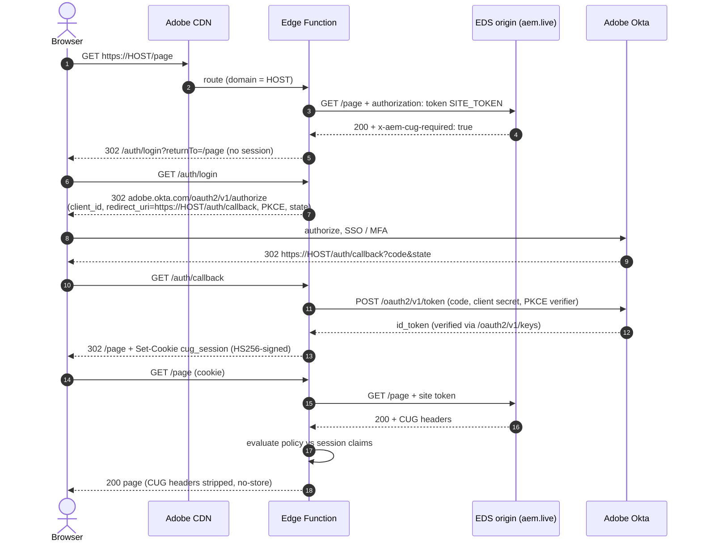

# Host an Edge Delivery site on an adobe.com CNAME behind Adobe Okta

Instructions for a GitHub Copilot agent (and the human driving it) to put an AEM Edge Delivery
Services (EDS) site on an `*.adobe.com` hostname, protected by Adobe corporate Okta (OIDC) through
an AEM Edge Function and Closed User Groups (CUG).

Reference rollout: `stage.xscknowledgehub.adobe.com` (program p153659, Edge Function
`knowledge-hub-stage-cug`, origin `stage--contentxscknowledgehub--adobedevxsc.aem.live`).

> **Agent rules.** Ask the user one question at a time with clickable choices. Never print or commit
> secrets (Okta client secret, session secret, site token, admin tokens). Steps marked **(human)**
> need a person with Adobe corporate access; give them exact values and wait.

## Internal links

| Purpose | Link |
|---|---|
| Service Registry (register the service/owner for the hostname) | https://adobe.service-now.com/service_registry_portal.do?path=/search#/search |
| Okta OIDC self-service (create/modify the Okta app) | https://oss.corp.adobe.com/okta/index.jsp |
| DNS self-service (create CNAME / `_acme-challenge` records) | https://devhome.corp.adobe.com/dns |
| Example DNS record (`xscknowledgehub.adobe.com` CNAME) | https://devhome.corp.adobe.com/dns/records/xscknowledgehub.adobe.com/CNAME/93235ec4-cd2b-4b3f-a38b-178f231951fb |
| Example DNS record (`_acme-challenge.xscknowledgehub.adobe.com`) | https://devhome.corp.adobe.com/dns/records/_acme-challenge.xscknowledgehub.adobe.com/CNAME/2cfea0cc-8d16-4150-a3dc-0f6e587c7d94 |
| Site admin (site tokens, access) | `https://tools.aem.live/tools/site-admin/index.html?org=<ORG>&site=<SITE>` |
| Cloud Manager | `https://experience.adobe.com/#/@<IMS_ORG>/cloud-manager/edge-delivery.html/program/<PROGRAM>` |
| CUG docs | https://www.aem.live/developer/closed-user-groups |
| Site authentication docs | https://www.aem.live/docs/authentication-setup-site |

## Architecture

```mermaid
flowchart LR
  U[Employee browser] -->|https://HOST| DNS[(adobe.com DNS<br/>CNAME → cdn.adobeaemcloud.com)]
  DNS --> CDN[Adobe AEM CDN<br/>Fastly, Adobe-managed cert]
  CDN -->|cdn.yaml origin selector<br/>domain = HOST| EF[AEM Edge Function<br/>&lt;site&gt;-cug]
  EF -->|/auth/* OIDC code flow| OKTA[Adobe Okta<br/>adobe.okta.com]
  EF -->|authorization: token SITE_TOKEN| EDS[EDS origin<br/>ref--site--org.aem.live<br/>site auth on]
  EDS -->|x-aem-cug-* headers<br/>from headers.json| EF
  CM[Cloud Manager<br/>config pipeline] -. deploys cdn.yaml,<br/>edgeFunctions.yaml, secrets .-> CDN
  CM -. secrets .-> EF
  SR[Service Registry] -. owns .-> DNS
```

Why each piece exists:
- **CNAME + Adobe-managed cert**: the hostname lives in adobe.com DNS; Cloud Manager issues the TLS
  cert after the `_acme-challenge` CNAME validates.
- **Edge Function**: does the Okta login, keeps a signed session cookie, and enforces CUG.
- **Site authentication on the EDS origin**: stops anyone bypassing the function via `*.aem.live`.
  Only the function holds the site token.
- **CUG headers**: tell the function which paths need login and which groups.

## Request sequence (end user)



Logout (`/auth/logout`) only clears the local cookies; the Adobe Okta self-service app has no
sign-out redirect URI.

## Inputs to collect

1. Public hostname, e.g. `<HOST>` = `mysite.adobe.com`.
2. EDS org / site / ref, and content source (DA or SharePoint).
3. Cloud Manager program ID, Edge Delivery environment, and IMS org that own the program.
4. Okta environment: **Production** (`https://adobe.okta.com`) unless told otherwise.
   Stage (`https://adobe-stage.okta.com`) and Preview (`https://adobe.oktapreview.com`) are separate
   tenants with **separate client IDs**.
5. Who may sign in: an Okta access group (e.g. `GRP-…`), and whether pages need group-level rules.

## Step 1: Service Registry (human)

In Service Registry, find or register the service that owns `<HOST>` (owner, support group,
environment). DNS and Okta requests commonly reference it.

## Step 2: Cloud Manager domain + DNS (human)

1. Cloud Manager → the Edge Delivery program → **Domains → Add domain** `<HOST>`, with an
   Adobe-managed (DV) certificate. Cloud Manager shows a verification value.
2. In DNS self-service create:

   | Record | Type | Value |
   |---|---|---|
   | `_acme-challenge.<HOST>` | CNAME | `<hash>.cm-verify.adobe.com` (from Cloud Manager) |
   | `<HOST>` | CNAME | `cdn.adobeaemcloud.com` |

3. Wait for the domain to verify and the certificate to deploy. Map the domain to the EDS site.

Verify:
```bash
dig +short CNAME <HOST>                    # cdn.adobeaemcloud.com.
dig +short CNAME _acme-challenge.<HOST>    # <hash>.cm-verify.adobe.com.
```

## Step 3: Okta OIDC app (human)

In Okta self-service create (or modify) a **Web / OIDC** app in the chosen environment:
- Sign-in redirect URI: `https://<HOST>/auth/callback` (exactly; not the `edgefunction-…` host).
- Grant type: Authorization Code. Scopes: `openid profile email` (+ `groups` if group rules needed).
- Assign the access group.
- Request a **groups claim** from the Okta admins if CUG rules use groups.

Record the client ID (not secret) and give the secret only to the secure stores.

Verify Okta accepts the redirect for that client (200 and no error = OK):
```bash
curl -s -o /tmp/o.html -w '%{http_code}\n' "https://adobe.okta.com/oauth2/v1/authorize?client_id=<CLIENT_ID>&response_type=code&scope=openid&state=x&nonce=x&redirect_uri=https%3A%2F%2F<HOST>%2Fauth%2Fcallback"
grep -c "parameter must" /tmp/o.html   # 0
```
A 400 from the issuer means the client ID belongs to a different Okta tenant.

## Step 4: Site token (EDS origin protection)

In site admin → **Authentication**, set protection to **Protected (preview + live)**, then under
**Access Tokens → Add Token** create a token (e.g. `edge-cug`) and copy the `hlx_…` value once.
Use **Access Tokens**, not **Manage Secrets**: a plain secret has no site access until linked.

```bash
curl -s -o /dev/null -w '%{http_code}\n' -H "authorization: token <VALUE>" https://<ref>--<site>--<org>.aem.live/   # 200
```

## Step 5: Edge Function

Start from a working reference (`edge-functions-knowledge-hub-stage-cug` in
`AdobeDevXSC/ContentXSCKnowledgeHub`, or `edge-functions-xsc-demo` in `ynaka-adobe/AEM-p154856`).
Must-haves:
- Hardcode `PUBLIC_HOST`, `PUBLIC_ORIGIN = https://<HOST>`, `ORIGIN_HOSTNAME` in `src/sites.js`.
- Build `redirect_uri` from `PUBLIC_ORIGIN`, never `request.url` (behind the CDN it is the
  `edgefunction-p…` host and Okta rejects it).
- `OKTA_LOCAL_LOGOUT: true`.
- Send `authorization: token <SITE_TOKEN>` only to the EDS origin; strip `x-aem-cug-*` from responses.
- Fail closed (503) if config is missing.

`npm test && npm run build`.

## Step 6: Config pipeline (`/config-eds`)

`cdn.yaml`:
```yaml
kind: "CDN"
version: "1"
data:
  originSelectors:
    rules:
      - name: route-<site>-cug
        when:
          allOf:
            - { reqProperty: domain, equals: "<HOST>" }
            - { reqProperty: path, notLike: "/adobe/experimental/compute*" }
        action:
          type: selectAemOrigin
          originName: edgefunction-<site>-cug
          skipCache: true
```

`edgeFunctions.yaml`:
```yaml
kind: "EdgeFunctions"
version: "1"
data:
  functions:
    - name: <site>-cug
  secrets:
    - { key: XSC_OKTA_ISSUER,        value: "${{XSC_OKTA_ISSUER}}" }
    - { key: XSC_OKTA_CLIENT_ID,     value: "${{XSC_OKTA_CLIENT_ID}}" }
    - { key: XSC_OKTA_CLIENT_SECRET, value: "${{XSC_OKTA_CLIENT_SECRET}}" }
    - { key: XSC_SESSION_SECRET,     value: "${{XSC_SESSION_SECRET}}" }
    - { key: XSC_SITE_TOKEN,         value: "${{XSC_SITE_TOKEN}}" }
```

**(human)** Set these as **secret variables on the Edge Delivery config pipeline**, then run it.


1. Cloud Manager → the program → **Pipelines**.
2. On the Edge Delivery config pipeline (e.g. "Stage Edge CDN", type *Production · Edge Delivery*)
   open **⋯ → View/Edit variables**.
3. For each name below: enter name and value, Step Applied **Deploy**, Type **Secret**, **Add**.
   Then **Save**, and **⋯ → Run** the pipeline.

Use the pipeline's variables, not a Cloud Manager environment's variables.

| Variable | Value |
|---|---|
| `XSC_OKTA_ISSUER` | `https://adobe.okta.com` (must match the client's tenant) |
| `XSC_OKTA_CLIENT_ID` | from Step 3 |
| `XSC_OKTA_CLIENT_SECRET` | from Step 3 |
| `XSC_SESSION_SECRET` | `openssl rand -base64 48` |
| `XSC_SITE_TOKEN` | `hlx_…` from Step 4 |

Variable changes apply only after the pipeline re-runs. No function redeploy is needed for them.

## Step 7: Deploy the function

Needs a plain Developer Console project (not App Builder) in the program's IMS org with an OAuth
Server-to-Server credential and the APIs **AEM CDN API**, **Cloud Manager** (Deployment Manager
profile), **Edge Delivery Services**. Download its JSON.

```bash
cd edge-functions-<site>-cug
aio config delete --global cloudmanager_orgid cloudmanager_programid cloudmanager_environmentid
aio logout && aio login -f --no-open          # open URL in a private window, pick the right org
aio aem edge-functions setup -c <project>.json
aio aem edge-functions info                   # check org, program, environment, site domain
aio aem edge-functions build
aio aem edge-functions deploy <site>-cug
aio aem edge-functions tail-logs <site>-cug
```

A stale **global** `cloudmanager_*` config silently overrides the org/environment; delete it.

## Step 8: Mark pages protected (CUG)

1. Create `closed-user-groups` at the site root (DA sheet, or SharePoint `closed-user-groups.xlsx`
   with tab `shared-default`):

   | url | cug-required | cug-groups | cug-login-path |
   |---|---|---|---|
   | `/**` | `true` | `logged-in` | |

   Leave cells empty (no literal `(blank)`). Preview + publish.
2. **Apply** it — publishing alone does nothing:
   - DA: add the Protected Pages plugin
     (`https://main--aem-apps--adobe-rnd.aem.live/tools/plugins/cug/cug.html`) to the `prepare`
     config sheet and apply.
   - SharePoint: write the headers via admin API (GET first and merge; POST overwrites):
     ```bash
     U=https://admin.hlx.page/config/<org>/sites/<site>/headers.json
     curl -s -H "x-auth-token: $ADMIN_TOKEN" $U
     curl -s -X POST -H "x-auth-token: $ADMIN_TOKEN" -H "content-type: application/json" $U \
       --data '{"/**":[{"key":"x-aem-cug-required","value":"true"},{"key":"x-aem-cug-groups","value":"logged-in"}]}'
     ```

## Step 9: Verify

```bash
H=https://<HOST>
curl -s -o /dev/null -w '%{http_code} %{redirect_url}\n' -H 'accept: text/html' $H/      # 302 → /auth/login
curl -s -o /dev/null -w '%{redirect_url}\n' $H/auth/login   # adobe.okta.com …client_id=<ID>&redirect_uri=https://<HOST>/auth/callback
curl -s -o /dev/null -w '%{redirect_url}\n' $H/auth/logout  # https://<HOST>/
```
Then sign in from a private browser window.

## Troubleshooting

| Symptom | Cause | Fix |
|---|---|---|
| Okta 400 "Your request resulted in an error" | Client ID not in that issuer's tenant | Match `XSC_OKTA_ISSUER` to the app's environment |
| Okta "redirect_uri must be a Login redirect URI" | URI not registered, or function sends `edgefunction-…` host | Register `https://<HOST>/auth/callback`; use `PUBLIC_ORIGIN` and redeploy |
| Plain-text `401 Unauthorized` on every page | EDS origin rejects the site token | Create via **Access Tokens**, update `XSC_SITE_TOKEN`, re-run pipeline |
| 503 from function | Missing config/secrets | Set all pipeline variables, re-run |
| Pages load anonymously | CUG not applied | Apply headers (Step 8.2) |
| `aio` deploys to wrong org/env | Global `cloudmanager_*` config | Delete global keys; check `info` |
| Logout errors at Okta | No sign-out URI on self-service apps | `OKTA_LOCAL_LOGOUT: true` |
| Group rules always deny | No groups claim in token | Ask Okta admins for a groups claim |
